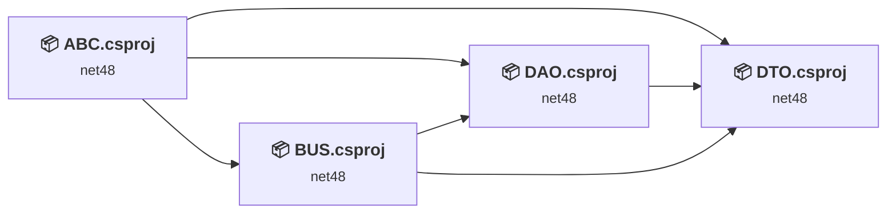
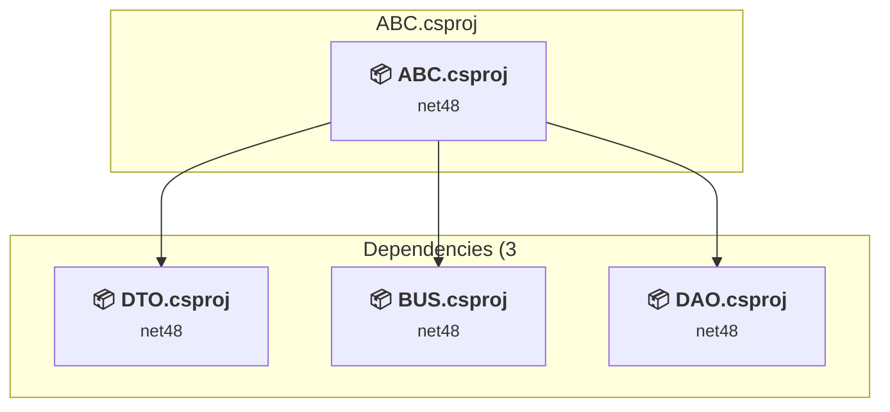
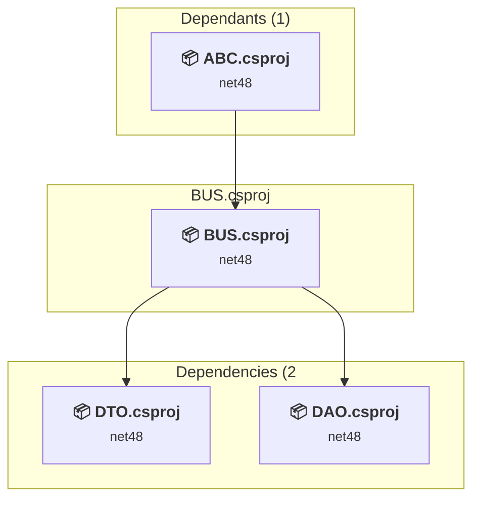
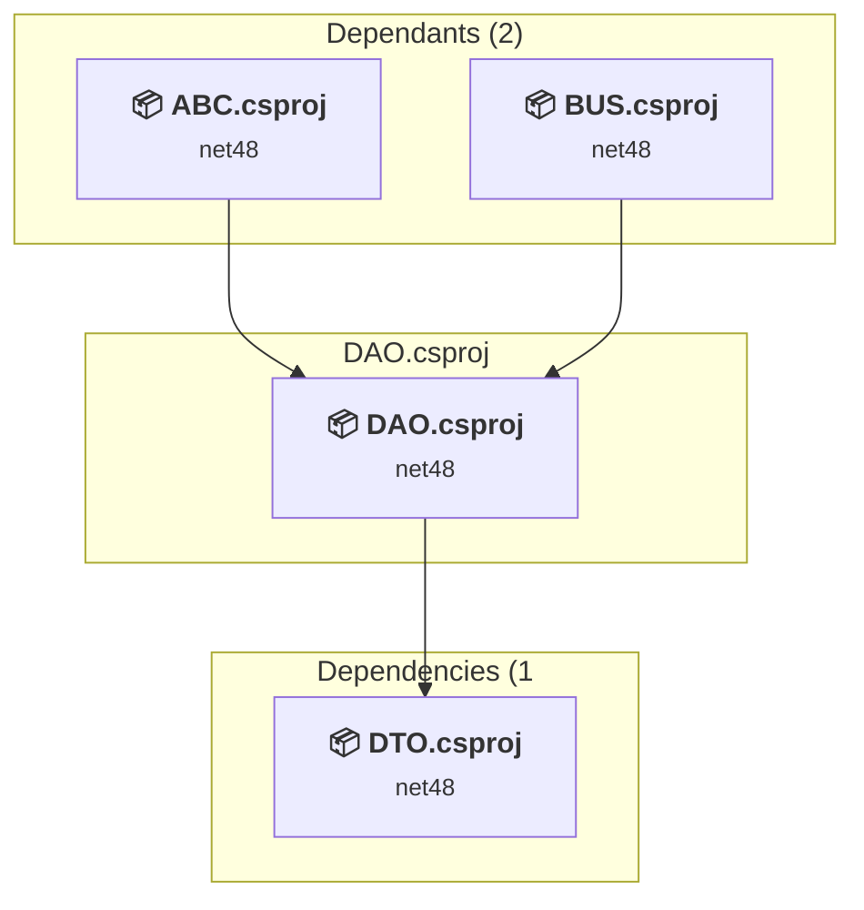
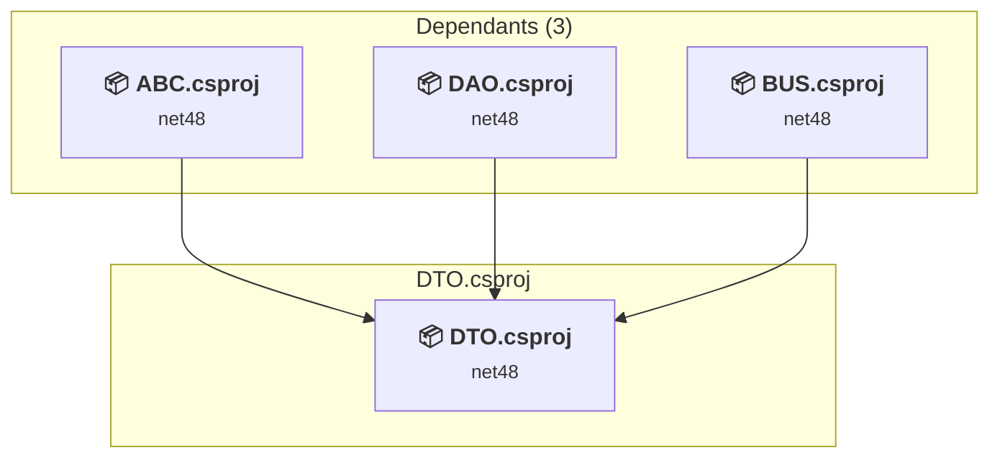

# Projects and dependencies analysis

This document provides a comprehensive overview of the projects and their dependencies in the context of upgrading to .NETFramework,Version=v4.8.

## Table of Contents

- [Executive Summary](#executive-Summary)
  - [Highlevel Metrics](#highlevel-metrics)
  - [Projects Compatibility](#projects-compatibility)
  - [Package Compatibility](#package-compatibility)
  - [API Compatibility](#api-compatibility)
  - [Binding Redirect Configuration](#binding-redirect-configuration)
- [Aggregate NuGet packages details](#aggregate-nuget-packages-details)
- [Top API Migration Challenges](#top-api-migration-challenges)
  - [Technologies and Features](#technologies-and-features)
  - [Most Frequent API Issues](#most-frequent-api-issues)
- [Projects Relationship Graph](#projects-relationship-graph)
- [Project Details](#project-details)

  - [src\ABC\ABC.csproj](#srcabcabccsproj)
  - [src\BUS\BUS.csproj](#srcbusbuscsproj)
  - [src\DAO\DAO.csproj](#srcdaodaocsproj)
  - [src\DTO\DTO.csproj](#srcdtodtocsproj)

## Executive Summary

### Highlevel Metrics

| Metric | Count | Status |
| :--- | :---: | :--- |
| Total Projects | 4 | 0 require upgrade |
| Total NuGet Packages | 16 | All compatible |
| Total Code Files | 143 |  |
| Total Code Files with Incidents | 0 |  |
| Total Lines of Code | 35007 |  |
| Total Number of Issues | 0 |  |
| Estimated LOC to modify | 0+ | at least 0.0% of codebase |

### Projects Compatibility

| Project | Target Framework | Difficulty | Package Issues | API Issues | Binding Issues | Est. LOC Impact | Description |
| :--- | :---: | :---: | :---: | :---: | :---: | :---: | :--- |
| [src\ABC\ABC.csproj](#srcabcabccsproj) | net48 | ✅ None | 0 | 0 | 0 |  | WinForms, Sdk Style = True |
| [src\BUS\BUS.csproj](#srcbusbuscsproj) | net48 | ✅ None | 0 | 0 | 0 |  | ClassLibrary, Sdk Style = True |
| [src\DAO\DAO.csproj](#srcdaodaocsproj) | net48 | ✅ None | 0 | 0 | 0 |  | ClassLibrary, Sdk Style = True |
| [src\DTO\DTO.csproj](#srcdtodtocsproj) | net48 | ✅ None | 0 | 0 | 0 |  | ClassLibrary, Sdk Style = True |

### Package Compatibility

| Status | Count | Percentage |
| :--- | :---: | :---: |
| ✅ Compatible | 16 | 100.0% |
| ⚠️ Incompatible | 0 | 0.0% |
| 🔄 Upgrade Recommended | 0 | 0.0% |
| ***Total NuGet Packages*** | ***16*** | ***100%*** |

### API Compatibility

| Category | Count | Impact |
| :--- | :---: | :--- |
| 🔴 Binary Incompatible | 0 | High - Require code changes |
| 🟡 Source Incompatible | 0 | Medium - Needs re-compilation and potential conflicting API error fixing |
| 🔵 Behavioral change | 0 | Low - Behavioral changes that may require testing at runtime |
| ✅ Compatible | 0 |  |
| ***Total APIs Analyzed*** | ***0*** |  |

## Aggregate NuGet packages details

| Package | Current Version | Suggested Version | Projects | Description |
| :--- | :---: | :---: | :--- | :--- |
| BCrypt.Net-Next | 4.0.3 |  | [ABC.csproj](#srcabcabccsproj) [BUS.csproj](#srcbusbuscsproj) [DAO.csproj](#srcdaodaocsproj) [DTO.csproj](#srcdtodtocsproj) | ✅Compatible |
| BouncyCastle.Cryptography | 2.4.0 |  | [ABC.csproj](#srcabcabccsproj) [BUS.csproj](#srcbusbuscsproj) [DAO.csproj](#srcdaodaocsproj) [DTO.csproj](#srcdtodtocsproj) | ✅Compatible |
| ClosedXML | 0.105.0 |  | [ABC.csproj](#srcabcabccsproj) [BUS.csproj](#srcbusbuscsproj) [DAO.csproj](#srcdaodaocsproj) [DTO.csproj](#srcdtodtocsproj) | ✅Compatible |
| ClosedXML.Parser | 2.0.0 |  | [ABC.csproj](#srcabcabccsproj) [BUS.csproj](#srcbusbuscsproj) [DAO.csproj](#srcdaodaocsproj) [DTO.csproj](#srcdtodtocsproj) | ✅Compatible |
| DocumentFormat.OpenXml | 3.1.1 |  | [ABC.csproj](#srcabcabccsproj) [BUS.csproj](#srcbusbuscsproj) [DAO.csproj](#srcdaodaocsproj) [DTO.csproj](#srcdtodtocsproj) | ✅Compatible |
| DocumentFormat.OpenXml.Framework | 3.1.1 |  | [ABC.csproj](#srcabcabccsproj) [BUS.csproj](#srcbusbuscsproj) [DAO.csproj](#srcdaodaocsproj) [DTO.csproj](#srcdtodtocsproj) | ✅Compatible |
| ExcelNumberFormat | 1.1.0 |  | [ABC.csproj](#srcabcabccsproj) [BUS.csproj](#srcbusbuscsproj) [DAO.csproj](#srcdaodaocsproj) [DTO.csproj](#srcdtodtocsproj) | ✅Compatible |
| iTextSharp | 5.5.13.4 |  | [ABC.csproj](#srcabcabccsproj) [BUS.csproj](#srcbusbuscsproj) [DAO.csproj](#srcdaodaocsproj) [DTO.csproj](#srcdtodtocsproj) | ✅Compatible |
| Microsoft.Bcl.HashCode | 1.1.1 |  | [ABC.csproj](#srcabcabccsproj) [BUS.csproj](#srcbusbuscsproj) [DAO.csproj](#srcdaodaocsproj) [DTO.csproj](#srcdtodtocsproj) | ✅Compatible |
| RBush.Signed | 4.0.0 |  | [ABC.csproj](#srcabcabccsproj) [BUS.csproj](#srcbusbuscsproj) [DAO.csproj](#srcdaodaocsproj) [DTO.csproj](#srcdtodtocsproj) | ✅Compatible |
| SixLabors.Fonts | 1.0.0 |  | [ABC.csproj](#srcabcabccsproj) [BUS.csproj](#srcbusbuscsproj) [DAO.csproj](#srcdaodaocsproj) [DTO.csproj](#srcdtodtocsproj) | ✅Compatible |
| System.Buffers | 4.5.1 |  | [ABC.csproj](#srcabcabccsproj) [BUS.csproj](#srcbusbuscsproj) [DAO.csproj](#srcdaodaocsproj) [DTO.csproj](#srcdtodtocsproj) | ✅Compatible |
| System.Data.SqlClient | 4.9.0 |  | [ABC.csproj](#srcabcabccsproj) [BUS.csproj](#srcbusbuscsproj) [DAO.csproj](#srcdaodaocsproj) [DTO.csproj](#srcdtodtocsproj) | ✅Compatible |
| System.Memory | 4.5.5 |  | [ABC.csproj](#srcabcabccsproj) [BUS.csproj](#srcbusbuscsproj) [DAO.csproj](#srcdaodaocsproj) [DTO.csproj](#srcdtodtocsproj) | ✅Compatible |
| System.Numerics.Vectors | 4.5.0 |  | [ABC.csproj](#srcabcabccsproj) [BUS.csproj](#srcbusbuscsproj) [DAO.csproj](#srcdaodaocsproj) [DTO.csproj](#srcdtodtocsproj) | ✅Compatible |
| System.Runtime.CompilerServices.Unsafe | 4.7.0 |  | [ABC.csproj](#srcabcabccsproj) [BUS.csproj](#srcbusbuscsproj) [DAO.csproj](#srcdaodaocsproj) [DTO.csproj](#srcdtodtocsproj) | ✅Compatible |

## Top API Migration Challenges

### Technologies and Features

| Technology | Issues | Percentage | Migration Path |
| :--- | :---: | :---: | :--- |

### Most Frequent API Issues

| API | Count | Percentage | Category |
| :--- | :---: | :---: | :--- |

## Projects Relationship Graph

Legend:
📦 SDK-style project
⚙️ Classic project

## Project Details

### src\ABC\ABC.csproj

#### Project Info

- **Current Target Framework:** net48✅
- **SDK-style**: True
- **Project Kind:** WinForms
- **Dependencies**: 3
- **Dependants**: 0
- **Number of Files**: 126
- **Lines of Code**: 19954
- **Estimated LOC to modify**: 0+ (at least 0.0% of the project)

#### Dependency Graph

Legend:
📦 SDK-style project
⚙️ Classic project

### API Compatibility

| Category | Count | Impact |
| :--- | :---: | :--- |
| 🔴 Binary Incompatible | 0 | High - Require code changes |
| 🟡 Source Incompatible | 0 | Medium - Needs re-compilation and potential conflicting API error fixing |
| 🔵 Behavioral change | 0 | Low - Behavioral changes that may require testing at runtime |
| ✅ Compatible | 0 |  |
| ***Total APIs Analyzed*** | ***0*** |  |

### src\BUS\BUS.csproj

#### Project Info

- **Current Target Framework:** net48✅
- **SDK-style**: True
- **Project Kind:** ClassLibrary
- **Dependencies**: 2
- **Dependants**: 1
- **Number of Files**: 16
- **Lines of Code**: 1992
- **Estimated LOC to modify**: 0+ (at least 0.0% of the project)

#### Dependency Graph

Legend:
📦 SDK-style project
⚙️ Classic project

### API Compatibility

| Category | Count | Impact |
| :--- | :---: | :--- |
| 🔴 Binary Incompatible | 0 | High - Require code changes |
| 🟡 Source Incompatible | 0 | Medium - Needs re-compilation and potential conflicting API error fixing |
| 🔵 Behavioral change | 0 | Low - Behavioral changes that may require testing at runtime |
| ✅ Compatible | 0 |  |
| ***Total APIs Analyzed*** | ***0*** |  |

### src\DAO\DAO.csproj

#### Project Info

- **Current Target Framework:** net48✅
- **SDK-style**: True
- **Project Kind:** ClassLibrary
- **Dependencies**: 1
- **Dependants**: 2
- **Number of Files**: 18
- **Lines of Code**: 12519
- **Estimated LOC to modify**: 0+ (at least 0.0% of the project)

#### Dependency Graph

Legend:
📦 SDK-style project
⚙️ Classic project

### API Compatibility

| Category | Count | Impact |
| :--- | :---: | :--- |
| 🔴 Binary Incompatible | 0 | High - Require code changes |
| 🟡 Source Incompatible | 0 | Medium - Needs re-compilation and potential conflicting API error fixing |
| 🔵 Behavioral change | 0 | Low - Behavioral changes that may require testing at runtime |
| ✅ Compatible | 0 |  |
| ***Total APIs Analyzed*** | ***0*** |  |

### src\DTO\DTO.csproj

#### Project Info

- **Current Target Framework:** net48✅
- **SDK-style**: True
- **Project Kind:** ClassLibrary
- **Dependencies**: 0
- **Dependants**: 3
- **Number of Files**: 23
- **Lines of Code**: 542
- **Estimated LOC to modify**: 0+ (at least 0.0% of the project)

#### Dependency Graph

Legend:
📦 SDK-style project
⚙️ Classic project

### API Compatibility

| Category | Count | Impact |
| :--- | :---: | :--- |
| 🔴 Binary Incompatible | 0 | High - Require code changes |
| 🟡 Source Incompatible | 0 | Medium - Needs re-compilation and potential conflicting API error fixing |
| 🔵 Behavioral change | 0 | Low - Behavioral changes that may require testing at runtime |
| ✅ Compatible | 0 |  |
| ***Total APIs Analyzed*** | ***0*** |  |

